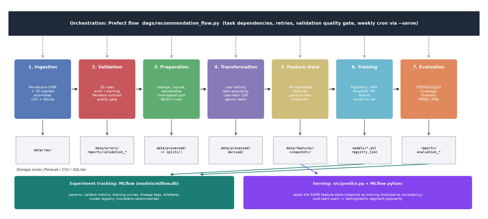
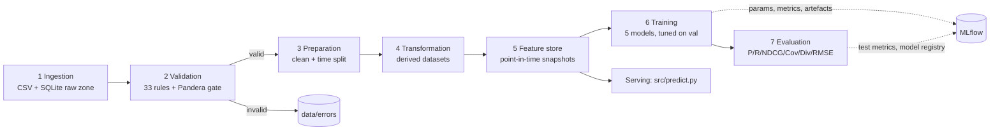

# End-to-End Data Management Pipeline for a Recommendation System

**DM4ML Assignment 2** | Roll No. 2025AG05355 | Repository: <https://github.com/k3rthicc/recommendation-pipeline>

A modular, reproducible pipeline that ingests the public **MovieLens-100K** dataset (users, movies, ratings), validates
and cleans it, builds derived datasets and a point-in-time feature store, trains and tunes five recommenders with
**MLflow** tracking, evaluates them on a strictly *future* test period, and runs the whole workflow as a **Prefect** flow.

| Deliverable | Where |
|---|---|
| Source code (modules per stage) | [`src/`](src) |
| Setup and execution instructions | [Section 3](#3-setup) and [Section 4](#4-running-the-pipeline) below |
| `requirements.txt` | [`requirements.txt`](requirements.txt) (pinned versions) |
| Architecture diagram | [`reports/figures/architecture.png`](reports/figures/architecture.png) and [Section 2](#2-architecture) |
| Data validation report and logs | [`reports/validation_report.md`](reports/validation_report.md), [`data/errors/`](data/errors), [`reports/logs/`](reports/logs) |
| Feature catalog (table) | [`reports/feature_catalog.md`](reports/feature_catalog.md) |
| Model evaluation and comparison | [`reports/model_comparison.md`](reports/model_comparison.md), [`reports/evaluation_results.md`](reports/evaluation_results.md) |
| Orchestration DAG and successful-run screenshot | [`dags/recommendation_flow.py`](dags/recommendation_flow.py), [`reports/screenshots/prefect_01_flow_run_graph.png`](reports/screenshots/prefect_01_flow_run_graph.png) |
| Final report (PDF) | [`reports/final_report.pdf`](reports/final_report.pdf) |
| Evidence index (requirement -> proof) | [`reports/evidence.md`](reports/evidence.md) |

---

## 1. Problem and dataset

The system recommends movies to users of an online movie platform from their past ratings and from item and user information.

| Entity | Source file | Rows (raw) | Content |
|---|---|---:|---|
| Users | `u.user` | 943 | user_id, age, gender, occupation, zip code |
| Items | `u.item` | 1,682 | item_id, title, release date, IMDb URL, 19 genre flags |
| Interactions | `u.data` | 100,000 | user_id, item_id, rating (1-5), Unix timestamp (Sep 1997 - Apr 1998) |

MovieLens is already clean, so ingestion appends **78 documented corrupted records** (missing values, duplicates, wrong types,
out-of-range ratings, impossible timestamps, broken foreign keys, badly formatted strings). Every injected record is listed in
`data/raw/injected_anomalies_log.csv`. This lets the validation and cleaning stages be shown working on realistic problems.
Injection can be switched off in `configs/config.yaml` (`ingestion.inject_anomalies: false`).

## 2. Architecture





All stages are orchestrated by the Prefect flow [`dags/recommendation_flow.py`](dags/recommendation_flow.py) and can also be run
one by one with `python -m src.pipeline --stage <name>`.

### Repository structure (as suggested in the assignment)

```
recommendation-pipeline/
├── data/
│   ├── raw/              # ingested CSVs (+ SQLite raw store, injected-anomaly log)
│   ├── processed/        # cleaned tables, validated/, splits/, derived/ datasets
│   ├── features/         # feature-store snapshots: validation/, train/
│   └── errors/           # quarantined records (<table>_errors.csv) and warnings
├── src/
│   ├── ingestion/        # ingest.py
│   ├── validation/       # validate.py (rules + Pandera contracts)
│   ├── preparation/      # prepare.py (cleaning + temporal split)
│   ├── transformation/   # transform.py (derived datasets)
│   ├── features/         # registry.py (feature definitions) + feature_store.py
│   ├── training/         # models.py, train.py, pyfunc.py (MLflow wrapper)
│   ├── evaluation/       # metrics.py, evaluate.py
│   ├── utils/            # config, logging, IO helpers
│   ├── pipeline.py       # plain-Python runner (all stages / one stage)
│   └── predict.py        # serving: top-K recommendations from the feature store
├── dags/                 # recommendation_flow.py (Prefect flow)
├── configs/              # config.yaml (all paths, thresholds, grids, seed)
├── models/               # registry.json (+ *.pkl, MLflow store - regenerated, git-ignored)
├── reports/              # reports, catalog, comparison, evidence, figures, screenshots, logs, final_report.pdf
│   └── build/            # scripts that produce screenshots, diagram and PDF
├── tests/                # pytest unit tests
├── Makefile
├── requirements.txt
└── README.md
```

## 3. Setup

Requirements: Python 3.12 (tested 3.12.x on macOS), internet access for the first download (5 MB).

```bash
git clone https://github.com/k3rthicc/recommendation-pipeline.git
cd recommendation-pipeline
python3.12 -m venv .venv && source .venv/bin/activate
pip install -r requirements.txt          # or: make setup
```

## 4. Running the pipeline

| Goal | Command |
|---|---|
| Run every stage in order | `python -m src.pipeline` (or `make pipeline`) |
| Run one stage | `python -m src.pipeline --stage ingest` (`validate`, `prepare`, `transform`, `features`, `train`, `evaluate`) |
| Run with Prefect (UI) | terminal 1: `prefect server start` -> terminal 2: `PREFECT_API_URL=http://127.0.0.1:4200/api python dags/recommendation_flow.py` |
| Scheduled weekly retraining | `python dags/recommendation_flow.py --serve` (cron `0 2 * * 1`) |
| Experiment tracking UI | `mlflow ui --backend-store-uri sqlite:///models/mlflow.db` -> <http://127.0.0.1:5000> |
| Get recommendations | `python -m src.predict --user-ids 1 945 --k 10 [--model hybrid]` |
| Unit tests | `pytest -q` |

A full run takes about 40 s on a laptop. All randomness is seeded (`project.seed: 42`), and two independent runs give identical metrics.

## 5. Process: what each stage does

### Stage 1 - Data ingestion (`src/ingestion/ingest.py`)
- Downloads `ml-100k.zip` from GroupLens (cached) and logs its MD5 checksum.
- Reads `u.user`, `u.item`, `u.data` **as strings**, so the raw zone keeps the data exactly as delivered and type problems are caught by validation, not by the reader.
- Appends the 78 documented anomalies (14 users, 9 items, 55 interactions).
- Adds lineage columns `_batch_id` and `_ingested_at` and writes `data/raw/{users,items,interactions}.csv` plus the same tables to a SQLite raw store (`data/raw/raw_store.db`).
- Writes an ingestion manifest (`reports/ingestion_manifest.json`) with row counts and file checksums.

### Stage 2 - Data validation (`src/validation/validate.py`)
33 automated rules in two severities:

| Severity | Examples | Action |
|---|---|---|
| **error** | missing or non-integer IDs, missing or non-numeric rating, rating outside 1-5, timestamp outside [1997-01-01, 1999-01-01), unknown `user_id` / `item_id` (referential integrity), invalid genre flags, missing title | record quarantined in `data/errors/<table>_errors.csv` with an `error_reasons` column and timestamp |
| **warning** | exact duplicates, conflicting duplicate keys, missing or invalid age, invalid gender, missing release date or IMDb URL, non-standard text formatting | record kept, listed in `data/errors/<table>_warnings.csv`, fixed in preparation |

The surviving records are type-cast and checked against **Pandera schema contracts** (column types, positive IDs, rating range, timestamp window, genre flags in {0,1}).
A contract failure stops the pipeline (quality gate). Outputs: `data/processed/validated/*.parquet`,
`reports/validation_report.{md,json}` (rule-level counts and a column profile).
**Result:** all 78 injected anomalies were detected. 38 records were quarantined (35 interactions, 2 users, 1 item), 51 records carried warnings, and all three contracts PASS.

### Stage 3 - Data preparation (`src/preparation/prepare.py`)
- Users: removes duplicates; sets invalid gender to `U`; imputes missing or invalid age with the **occupation median**; lower-cases and trims occupation; adds `age_bucket`.
- Items: removes duplicates; trims titles; imputes missing release dates from the year in the title; drops `video_release_date` (100% null); adds a `genres` string and `n_genres`.
- Interactions: removes exact duplicates; resolves conflicting re-ratings by **keeping the latest**; standardises timestamps to UTC.
- **Time-based split:** global cut-off at the 80th timestamp percentile (1998-03-07). Train has 80,003 ratings and test has 19,997, with an asserted no-leakage check `max(train.ts) < min(test.ts)`. A second cut-off inside train (last 10%) gives `train_inner`/`val` for hyper-parameter tuning.
- Every action is counted in `reports/preparation_report.json`.

### Stage 4 - Data transformation (`src/transformation/transform.py`)
Builds derived datasets from the **training period only**, in `data/processed/derived/`:
`user_activity_summary` (volume, mean/std rating, active days, tenure), `item_popularity` (count, mean, Bayesian average, rank),
`item_genres` (long format), `daily_activity`, and the sparse **user-item interaction matrix** (`user_item_matrix.npz`, 952 x 1,688,
95.0% sparse) with its ID index.

### Stage 5 - Feature management (`src/features/`)
- `registry.py` defines **49 features** (16 user, 30 item including 19 genre flags, 3 user-item), each with entity, type, description, logic, source and consumer. The catalog [`reports/feature_catalog.md`](reports/feature_catalog.md) is generated from this registry.
- `feature_store.py` materialises **point-in-time snapshots**: `validation` (as of the validation cut-off) and `train` (as of the test cut-off). Each has parquet files plus `metadata.json` (as_of, row counts, data fingerprint). Materialisation fails if any produced column is not registered.
- The same `FeatureStore` API serves training (hybrid content signal, cold-start segments), evaluation (genre vectors, popularity) and prediction (`src/predict.py`), which keeps training and serving consistent.

### Stage 6 - Model training (`src/training/`)
| Model | Idea |
|---|---|
| `popularity` (baseline) | most-rated unseen items, Bayesian-average rating |
| `item_knn` | item-item cosine similarity with shrinkage, top-N neighbours |
| `pure_svd` | truncated SVD of the rating matrix (MF for top-N) |
| `biased_mf` | Funk-SVD with user/item biases, mini-batch SGD (MF for ratings) |
| `hybrid` | weighted blend of standardised PureSVD, kNN, MF, genre-affinity and popularity scores, plus demographic-segment popularity for cold-start users |

Hyper-parameters are tuned on `train_inner -> val`: ranking models by NDCG@10, the MF by RMSE, plus a 54-combination hybrid weight grid.
Each candidate is a nested MLflow run. Final models are refit on the full training period, and each gets an MLflow run with
parameters, validation metrics, the training curve, lineage tags (git commit, data fingerprint, feature snapshot) and artefacts.

### Stage 7 - Model evaluation (`src/evaluation/`)
Precision@10, Recall@10, NDCG@10, HitRate@10, Coverage@10, Diversity@10, Novelty@10, RMSE and MAE, overall and split by
warm and cold-start users. Test metrics are logged back to each model's MLflow run, and the best model (by NDCG@10) is logged as an
MLflow **pyfunc** and registered as `movielens-recommender`.

| Model | P@10 | R@10 | NDCG@10 | Coverage | Diversity | RMSE | MAE |
|---|---:|---:|---:|---:|---:|---:|---:|
| popularity (baseline) | 0.2293 | 0.0847 | 0.2537 | 0.046 | 0.786 | 1.0332 | 0.8354 |
| item_knn | 0.2266 | 0.0776 | 0.2463 | 0.152 | 0.782 | 1.0464 | 0.8401 |
| pure_svd | 0.2369 | 0.0885 | 0.2619 | 0.157 | 0.774 | n/a | n/a |
| biased_mf | 0.2131 | 0.0774 | 0.2384 | 0.065 | 0.762 | 1.0199 | 0.8203 |
| **hybrid** | **0.2586** | **0.0912** | **0.2878** | 0.147 | 0.685 | **1.0199** | **0.8203** |

The hybrid improves NDCG@10 by 13.4% over the popularity baseline. See [`reports/model_comparison.md`](reports/model_comparison.md) for the full analysis.

### Orchestration (`dags/recommendation_flow.py`)
Prefect flow `recommendation-pipeline` with 8 tasks:
`ingest -> validate -> prepare -> transform -> features -> train -> evaluate -> publish-summary`.
Each task receives the output of its upstream task, so Prefect enforces the dependency order. Ingestion retries twice, validation acts as
a quality gate, every task is idempotent, and the flow publishes Prefect artifacts (validation summary table and model comparison markdown).
`--serve` deploys it with a weekly cron schedule.

## 6. Reproducibility

- One config file (`configs/config.yaml`), a fixed seed, and pinned `requirements.txt`.
- Ingestion manifest with checksums, a data fingerprint per feature snapshot, and the git commit tagged on every MLflow run.
- Idempotent stages: re-running overwrites outputs deterministically. Stage-by-stage and Prefect runs produced identical metrics.
- 8 unit tests (`tests/`): metric correctness, validation rules, no temporal leakage, keep-latest de-duplication, point-in-time features.
- Large regenerable artefacts (model pickles, MLflow store, raw archive) are git-ignored and recreated by `make pipeline`.

## 7. Limitations

- MovieLens-100K is small and dense compared with production data. Anomalies are synthetic (documented) rather than organic.
- Static batch evaluation: models are not updated during the 6-week test period, which penalises all models for test-period cold-start users.
- The genre-affinity content signal is coarse (19 genres) and received zero weight in tuning. Richer content (plots, tags, embeddings) would be needed.
- Offline metrics only. There is no online A/B test, and popularity bias in the logged data favours popular items.
- The feature store is a custom file-based layer (no online low-latency store such as Feast + Redis).

## 8. Evidence

Screenshots of every stage, the Prefect UI and the MLflow UI are in [`reports/screenshots/`](reports/screenshots) and indexed in
[`reports/evidence.md`](reports/evidence.md). They are also compiled into [`reports/final_report.pdf`](reports/final_report.pdf).
