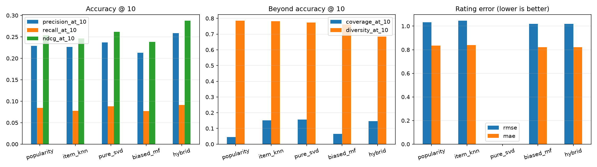

# Model Evaluation Results

Held-out test period: interactions after the temporal cut-off (19997 ratings). K = 10; relevant = rating >= 4.
Evaluated users: 290 (98 warm, 192 cold-start).

|            |   precision@10 |   recall@10 |   ndcg@10 |   hit_rate@10 |   coverage@10 |   diversity@10 |   novelty@10 |     rmse |      mae |   warm_ndcg@10 |   cold_ndcg@10 |
|:-----------|---------------:|------------:|----------:|--------------:|--------------:|---------------:|-------------:|---------:|---------:|---------------:|---------------:|
| popularity |         0.2293 |      0.0847 |    0.2537 |        0.7621 |        0.0456 |         0.7856 |       7.7793 |   1.0332 |   0.8354 |         0.1331 |         0.3153 |
| item_knn   |         0.2266 |      0.0776 |    0.2463 |        0.7483 |        0.1517 |         0.7824 |       8.022  |   1.0464 |   0.8401 |         0.1111 |         0.3153 |
| pure_svd   |         0.2369 |      0.0885 |    0.2619 |        0.7724 |        0.157  |         0.7738 |       8.0037 | nan      | nan      |         0.1573 |         0.3153 |
| biased_mf  |         0.2131 |      0.0774 |    0.2384 |        0.7138 |        0.0652 |         0.762  |       8.8751 |   1.0199 |   0.8203 |         0.0877 |         0.3153 |
| hybrid     |         0.2586 |      0.0912 |    0.2878 |        0.7483 |        0.1469 |         0.6849 |       8.1583 |   1.0199 |   0.8203 |         0.1647 |         0.3507 |

**Best model by NDCG@10: `hybrid`** (registered in MLflow as `movielens-recommender` v1).

Personalised models (item-kNN, MF) use global popularity for cold-start users; the hybrid uses demographic segment popularity.
Coverage = share of the catalogue recommended to at least one user; Diversity = 1 - mean pairwise genre cosine similarity within a list.

