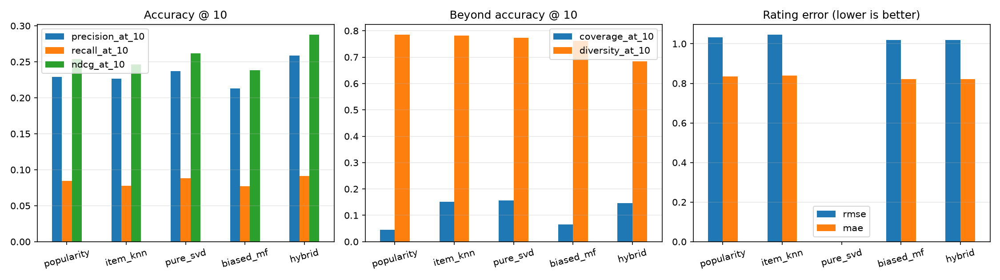

# Model Comparison

This document compares the recommenders trained by `src/training/train.py` and evaluated by
`src/evaluation/evaluate.py`. All numbers are produced by the pipeline (raw output:
[`evaluation_results.csv`](evaluation_results.csv), [`evaluation_results.json`](evaluation_results.json),
MLflow experiment `dm4ml-recommendation-pipeline`). Two independent end-to-end runs (stage-by-stage CLI
and Prefect flow) produced **identical** metrics (max absolute difference 0.0), so the results are reproducible.

## 1. Evaluation protocol

| Item | Choice |
|---|---|
| Split | Global **time-based** split: interactions up to 1998-03-07 02:21 UTC (80th timestamp percentile) are training data, everything after is test data. No test-period information reaches features or models. |
| Test set | 19,997 ratings, 301 users. 290 users have at least one relevant item: **98 warm** (seen in training) and **192 cold-start** (no history before the cut-off). |
| Relevance | A test item is relevant if its rating is >= 4. |
| Candidates | Whole catalogue (1,688 items) minus items the user already rated in training. |
| K | 10 |
| Ranking metrics | Precision@10, Recall@10, NDCG@10 (binary gain), HitRate@10 |
| Beyond accuracy | Coverage@10 (share of catalogue recommended to at least one user), Diversity@10 (1 - mean pairwise cosine similarity of the genre vectors within a list), Novelty@10 (mean -log2 popularity share) |
| Rating accuracy | RMSE and MAE on all 19,997 test ratings (fallbacks: unknown user -> item bias / Bayesian average; unknown item -> user bias / global mean) |
| Model selection | Hyper-parameters chosen on an inner temporal validation split (last 10% of the training period), never on the test set. |

## 2. Models

| Model | Type | Selected hyper-parameters (validation) | Cold-start handling |
|---|---|---|---|
| `popularity` (**baseline**) | Non-personalised: most-rated items (min. 10 ratings), Bayesian average for rating prediction | `min_ratings=10` | same list for everyone |
| `item_knn` | Item-based collaborative filtering, cosine on binary interactions with shrinkage, top-N neighbours | `neighbours=40` (grid 20/40/80), `shrinkage=10` | global popularity |
| `pure_svd` | Matrix factorisation for top-N (truncated SVD of the rating matrix) | `n_factors=10` (grid 10/20/50) | global popularity |
| `biased_mf` | Matrix factorisation for rating prediction (Funk-SVD, mini-batch SGD, 40 epochs) | `n_factors=50, reg=0.1` (grid 20/50 x 0.05/0.1), selected by validation RMSE | global popularity |
| `hybrid` | z(PureSVD) + w_knn z(kNN) + w_mf z(MF) + w_c z(genre affinity) + w_p z(popularity); demographic cold-start | `w_mf=0.5`, `w_knn=0`, `w_c=0`, `w_p=0` (54-combination grid, [hybrid_weight_search.csv](hybrid_weight_search.csv)) | **most-liked items of the user's age band x gender segment** (feature store) |

## 3. Results on the held-out test period (K = 10)

| Model | Precision@10 | Recall@10 | NDCG@10 | HitRate@10 | Coverage@10 | Diversity@10 | Novelty@10 | RMSE | MAE |
|---|---:|---:|---:|---:|---:|---:|---:|---:|---:|
| popularity (baseline) | 0.2293 | 0.0847 | 0.2537 | 0.7621 | 0.0456 | **0.7856** | 7.78 | 1.0332 | 0.8354 |
| item_knn | 0.2266 | 0.0776 | 0.2463 | 0.7483 | 0.1517 | 0.7824 | 8.02 | 1.0464 | 0.8401 |
| pure_svd | 0.2369 | 0.0885 | 0.2619 | **0.7724** | **0.1570** | 0.7738 | 8.00 | n/a | n/a |
| biased_mf | 0.2131 | 0.0774 | 0.2384 | 0.7138 | 0.0652 | 0.7620 | **8.88** | **1.0199** | **0.8203** |
| **hybrid** | **0.2586** | **0.0912** | **0.2878** | 0.7483 | 0.1469 | 0.6849 | 8.16 | **1.0199** | **0.8203** |

The hybrid delegates rating prediction to its biased-MF component, so its RMSE and MAE equal those of `biased_mf`.
PureSVD scores items from a zero-filled matrix and does not produce calibrated ratings, so RMSE and MAE are not reported for it.

### Warm vs cold-start users

| Model | Warm P@10 (n=98) | Warm NDCG@10 | Cold P@10 (n=192) | Cold NDCG@10 | RMSE (warm users only) |
|---|---:|---:|---:|---:|---:|
| popularity | 0.1071 | 0.1331 | 0.2917 | 0.3153 | 1.0363 |
| item_knn | 0.0990 | 0.1111 | 0.2917 | 0.3153 | 1.1222 |
| pure_svd | 0.1296 | 0.1573 | 0.2917 | 0.3153 | n/a |
| biased_mf | 0.0592 | 0.0877 | 0.2917 | 0.3153 | **0.9727** |
| **hybrid** | **0.1347** | **0.1647** | **0.3219** | **0.3507** | **0.9727** |



## 4. Discussion

1. **Hybrid is the best model** on every accuracy metric that matters for top-N: NDCG@10 is **+13.4%** over the popularity baseline
   (0.2878 vs 0.2537), Precision@10 +12.8% and Recall@10 +7.7%. It was registered in the MLflow model registry as `movielens-recommender`.
2. **Where the gain comes from.** For warm users the PureSVD + MF blend improves NDCG@10 by +23.7% over popularity (0.1647 vs 0.1331).
   For cold-start users, who make up two thirds of the test users because of the strict time-based split, demographic segment popularity
   (age band x gender from the feature store) improves NDCG@10 by +11.2% over global popularity (0.3507 vs 0.3153).
3. **Rating prediction vs ranking.** Biased MF has the lowest RMSE (0.9727 on warm users vs 1.0363 for the Bayesian-average baseline)
   but the *worst* ranking quality. Minimising squared error rewards predicting the rating value well, and its top-N lists are dominated by
   rarely rated, highly rated films (highest novelty, 8.88). PureSVD models *which* items a user rates and ranks much better.
   This is why the hybrid combines both signals.
4. **Popularity is a strong baseline** on MovieLens. Item-kNN alone does not beat it on precision under a temporal split, but it has
   3.3x the catalogue coverage (15.2% vs 4.6%).
5. **Accuracy vs diversity trade-off.** The hybrid has the lowest intra-list diversity (0.685). Most of the drop comes from cold-start
   users: their segment-popularity lists have diversity 0.668, compared with 0.805 for the global popularity list, because a demographic
   segment's favourites share genres. For warm users the hybrid (0.718) is close to PureSVD (0.712). Item-kNN, PureSVD and the hybrid
   recommend 3.2-3.4x more of the catalogue than the baseline (coverage 14.7-15.7% vs 4.6%).
6. **Content signal.** The validation search gave the genre-affinity feature weight 0: with 19 coarse genres it adds no information beyond
   the collaborative signal. It is still materialised and served by the feature store, and it is shown in `src/predict.py` output for explainability.

## 5. How to reproduce

```bash
make pipeline        # or: python -m src.pipeline
make mlflow-ui       # http://127.0.0.1:5000 -> experiment dm4ml-recommendation-pipeline
```
